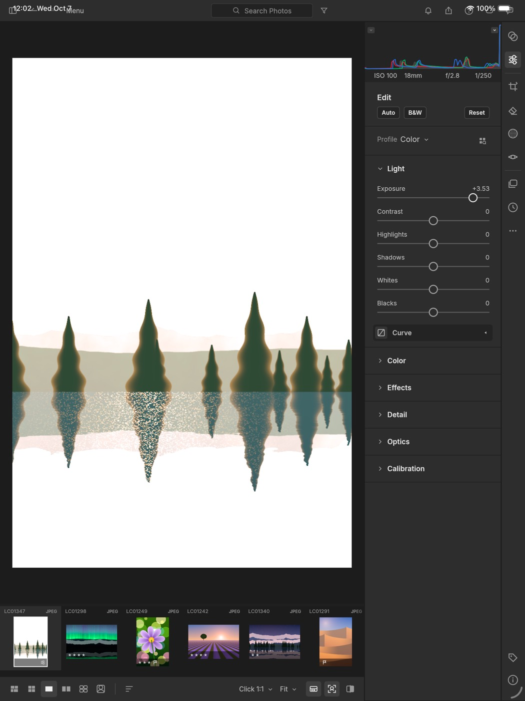
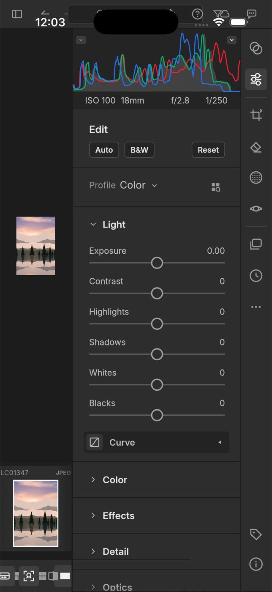
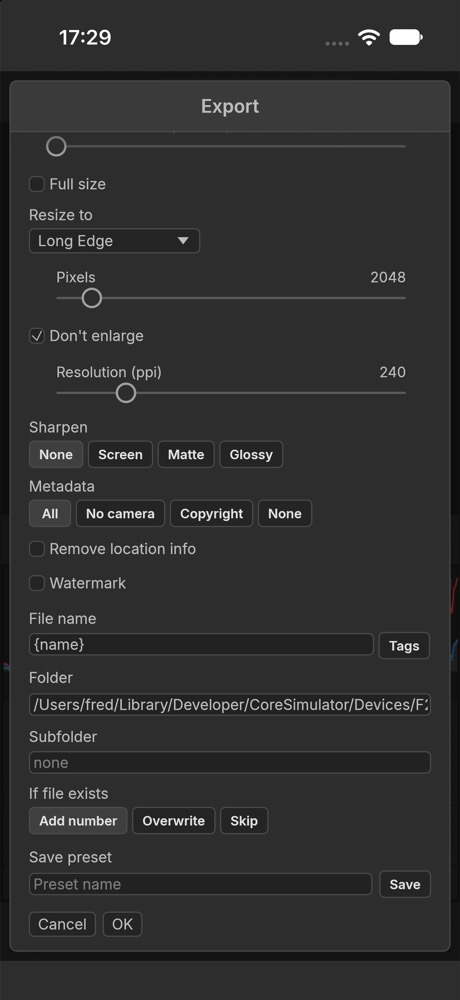
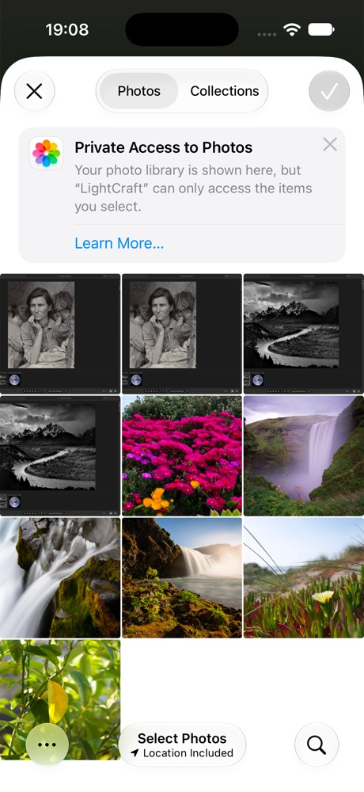
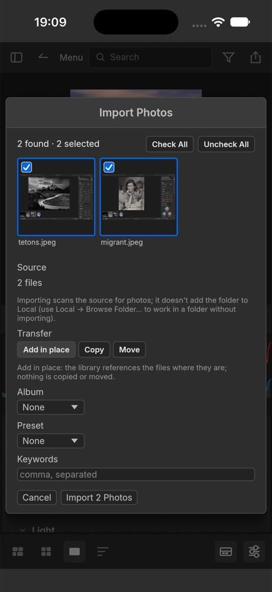
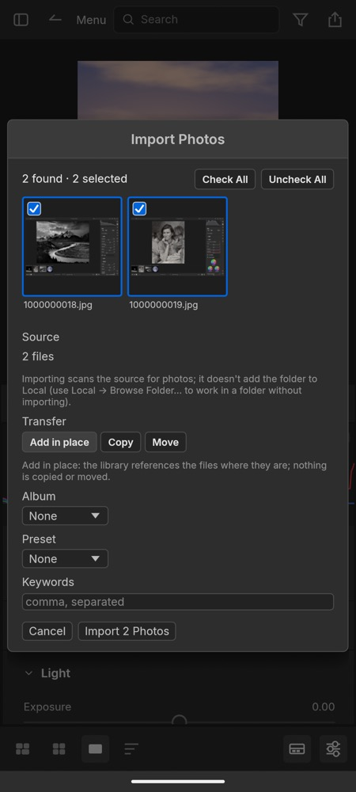
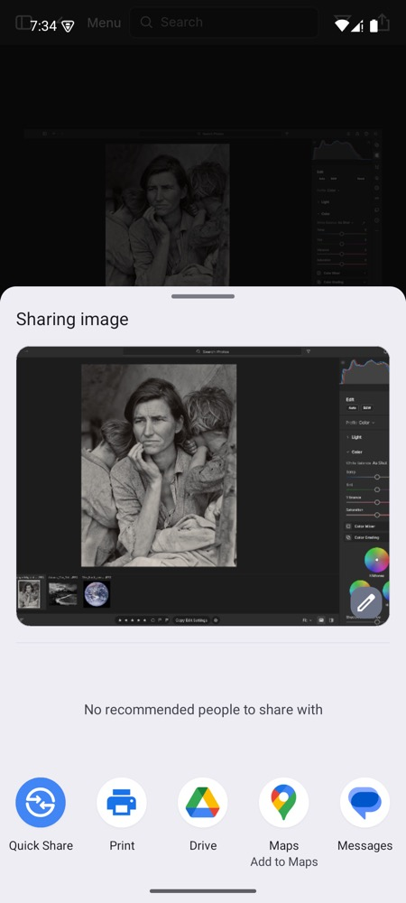

# LightCraft mobile (spike)

The desktop egui UI and engine, **unmodified**, in a thin iOS/iPadOS or Android shell. It's a
feasibility spike, not a usable mobile app. The assessment, the effort estimate and the blockers
are in [docs/porting-report.md](docs/porting-report.md).

| iPad (iOS 26.5 Simulator) | iPhone, before the compact layout | Android tablet (API 35 emulator) |
|---|---|---|
|  |  |  |

## Build and run

The rest of the workspace builds this crate empty. It only has code for `target_os = "ios"` and
`"android"`.

```sh
rustup target add aarch64-apple-ios-sim aarch64-linux-android
apps/lightcraft-mobile/scripts/ios-sim.sh            # booted simulator, or pass a device name/UDID
apps/lightcraft-mobile/scripts/android-apk.sh --run  # builds the APK; --run installs and starts it via adb
```

If `cargo` on `PATH` isn't rustup's, set `CARGO` (for example
`CARGO="rustup run stable cargo"`) so the mobile targets' standard libraries are found.

## What works

- The library opens on disk in the sandbox, seeded with the demo photos. On iOS it's
  `Documents/LightCraft Library`; on Android it's the app's internal data dir.
- The grid, the loupe and every develop control work. A touch drag on a slider renders live.
- GPU compute runs on Metal (iOS). Edits survive a hard kill, because the journal is fsynced
  per command.

## Phone layout

Below 600pt of width (inside the safe area), `lightcraft-ui-egui` switches to a compact layout
(`crates/ui-egui/src/panels/compact.rs`). It's used on phones, iPad Split View and phone
browsers:

- **Top bar:** My Photos, Back, Menu, a search field, Filter and Export.
- **Detail view:** the photo on top, and a bottom sheet with a tool row (Presets, Edit, Crop,
  Remove, Masking, Info …). The sheet shows that panel at full width; Hide puts it away.
- **My Photos:** a full-width drawer that closes when you pick a source.
- **Grid:** about three thumbnails across.
- **Bottom bar:** view modes, Sort, Filmstrip and an Edit toggle.
- **Loupe gestures:** pinch zooms about the fingers, from Fit to 1600%, and pinching back in
  snaps to Fit. Moving both fingers pans. At Fit, a one-finger swipe sideways drags the photo
  along, and letting go past a sixth of the screen shows the next or previous photo. When
  zoomed in, one finger pans as before. A trackpad pinch (or ⌘/Ctrl-scroll) over the loupe
  zooms on the desktop too.
- **Sliders by touch:** a drag that starts sideways adjusts the slider by the distance moved;
  one that starts up or down scrolls the panel, even when it begins on a slider's track. A tap
  doesn't change the value, and double-tap resets. Mouse and trackpad work as on the desktop.
- **Import from the photo library:** File ▸ Import Photos… opens the system picker (PHPicker
  on iOS, Android's photo picker). The chosen photos are copied into `<library>/Picked`, then
  the usual Import review opens. On iOS each photo is fetched as its raw file when it has one,
  as JPEG/PNG/TIFF/WebP when it already is one, and otherwise as JPEG. LightCraft has no HEIC
  decoder yet, so iOS converts HEIC photos (`src/ios_picker.rs`). Android uses a small Java
  subclass of NativeActivity (`android/java/…/LightCraftActivity.java`), compiled by
  `scripts/android-apk.sh` with `javac` and `d8`, because NativeActivity can't receive an
  activity result.
- **Surviving a reinstall (iOS):** iOS gives a reinstalled or updated app a new container
  path, but the catalog stores absolute paths. When the library opens, the engine relinks
  photos that were inside the library at its old location (such as `Picked/` copies) to the
  same place in the library now. This is general, so it also covers a moved library folder on
  the desktop (`lightcraft_engine::cmd::missing::plan_moved_library`).
- **Memory budget:** set from what the platform allows the process: iOS's jetsam limit
  (`os_proc_available_memory`; the Simulator has none, so half the Mac's RAM), and half the
  RAM on Android. The budget is 40% of that, from 256 MiB to 1 GiB, with 3 decoded previews
  and a 512 MB thumbnail cache. On a memory warning (iOS `didReceiveMemoryWarning`, Android
  `onTrimMemory`, checked every second) the budget drops by a quarter at once, the GPU pool
  is trimmed, free allocator pages go back to the system, and the caches evict on the next
  frame (`src/memory.rs`). Log lines start with `memory:`.
- **Export and share:** exports go to a folder next to the library (`Documents/LightCraft
  Exports` on iOS, so they show in the Files app; the app's private files on Android). When an
  export from the Export dialog finishes, the share sheet opens with the files: AirDrop, Save
  to Photos, Messages and other apps. On iOS that's UIActivityViewController
  (`src/ios_share.rs`, anchored as a popover on iPad). On Android it's an `ACTION_SEND` chooser
  over `content://` URIs from a small read-only `FilesProvider` (androidx's FileProvider
  without androidx). `ui-egui` gained two optional host services for this, `export_dir` and
  `share`.
- **Soft keyboard:** the layout moves up above the keyboard (bottom bar, sheet, dialogs), and a
  focused text field it would cover is scrolled into view. On iOS the shell's scene delegate
  reads the keyboard frame from UIKit. On Android the shell compares the decor view's
  `getWindowVisibleDisplayFrame` with the window's bounds over JNI
  (`src/android_jni.rs`), which also keeps the UI clear of the navigation bar. Either way
  the result becomes egui's safe-area insets.
- **Dialogs:** Export, Import, Settings, Merge and the rest span the screen width and scroll
  when they're taller than it. Labels sit above their controls, and button rows wrap. The Merge
  preview stacks above its options, and the Shortcuts table scrolls sideways.

The whole UI stays inside the iOS safe area (status bar, Dynamic Island, home indicator).

| | Edit sheet | Grid | My Photos | Export dialog | Typing a caption |
|---|---|---|---|---|---|
| iPhone 17 (iOS 27) |  |  |  |  |  |

| Photo picker (iOS) | Import review (iOS) | Import review (Android) | Share sheet (iOS) | Share sheet (Android) |
|---|---|---|---|---|
|  |  |  |  |  |

## Known problems

- **iOS scene lifecycle is adopted by the shell, not winit.** winit 0.30 has no UIScene support,
  and iOS 27 kills apps without it. `src/ios_scene.rs` and the scene manifest in `ios/Info.plist`
  attach winit's window to the scene, which works on iOS 26.5 and 27.0. There's one scene only
  (no multiwindow), and this goes away when eframe moves to winit 0.31.
- **Phone layout is a first pass.** Narrow windows get a compact layout and phone-sized
  dialogs (see below). There's no landscape-specific arrangement.
- **Soft keyboard.** On iOS, tapping the photo to dismiss the keyboard also toggles its zoom.
  On Android the insets are polled (about 12 times a second while typing, twice a second
  otherwise), so the layout follows the keyboard a moment late. Typing goes through
  NativeActivity's key events, which works for plain text. Composing input (CJK, autocorrect,
  swipe typing) is untested and probably doesn't work. Full IME support needs GameActivity.
- **Touch.** Some controls appear only on hover, and the desktop layout's hit targets are
  small. There's no inertia when panning a zoomed photo, and no double-tap-to-zoom gesture
  beyond the existing tap toggle. The tone curve and color wheels still take every drag that
  starts on them, since they're two-dimensional controls.
- **Memory: large exports aren't bounded yet.** A single huge raw decode can still go past
  the budget (the engine's decode gate always lets one job through), and the GPU renders
  whole-image buffers. Older 3–4 GB phones may need a lower cap or tiled exports.
- **Import caveats.** Picked photos are copied into `<library>/Picked`, so they take up space
  twice. On Android the picker hides original file names, so photos arrive named after their
  media IDs, and HEIC/HEIF is converted to JPEG on the Java side (losing EXIF). Raw files from
  the photo library haven't been tried on either platform, because there was no raw sample to
  add to the simulators.
- **Android.** The window uses GL, because the emulator's Vulkan surface fails to configure;
  `adb shell touch /data/local/tmp/lc_vulkan` tries Vulkan. Logs go to logcat, tag
  `LightCraft` (`adb logcat -s 'LightCraft:*'`).
